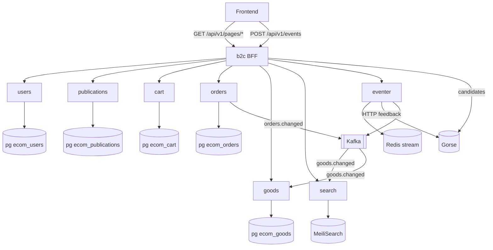
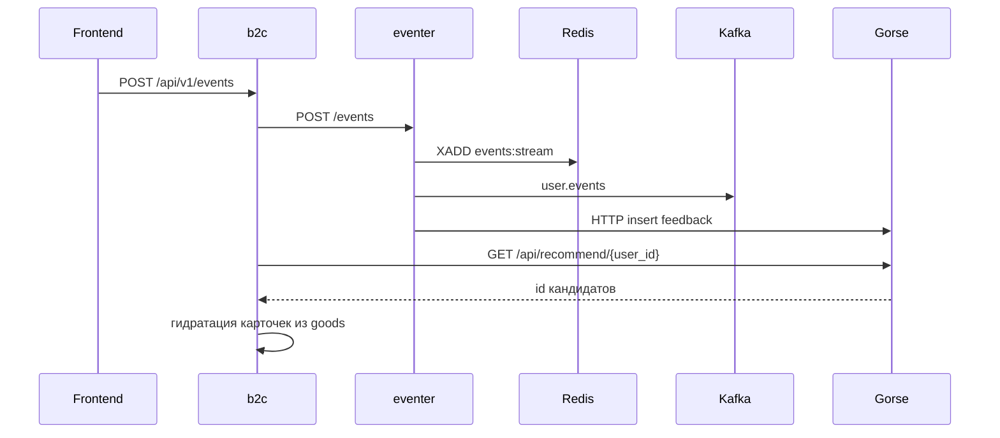

# Архитектура B2C-части

## Принципы

1. С фронтом общается только `b2c`. Остальные сервисы не выставлены наружу и не знают друг о друге.
2. Одна страница фронта - одна GET-ручка `b2c`, возвращающая типизированную модель страницы.
3. У каждого сервиса своя база. Межсервисных джойнов нет, связь - через HTTP или Kafka.
4. Страница не падает целиком из-за одного апстрима: секции деградируют независимо.

## Карта сервисов



## Слои внутри b2c

Зависимости идут строго в одну сторону:

```
api/v1/pages/*      разбор запроса, подстановка текущего пользователя
      v
services/*_page.py  сборщик страницы: веерный запрос к апстримам, склейка секций
      v
mappers/*           upstream DTO -> модели карточек страницы
      v
clients/*           HTTP-клиенты апстримов, возвращают DTO
```

Сборщик страницы никогда не ходит в HTTP напрямую, а клиент ничего не знает о моделях страниц.
Благодаря этому любой апстрим можно заменить, переписав только его клиент.

## Деградация секций

Сборщики используют `gather_sections` из [services/b2c/gather.py](../services/b2c/gather.py): корутины выполняются параллельно, каждый результат оборачивается в `Section[T]` со статусом:

- `ok` - данные получены;
- `empty` - апстрим ответил, но данных нет;
- `unavailable` - апстрим недоступен или ответил ошибкой.

Критичные для страницы данные (например, сам товар на карточке товара) запрашиваются отдельно и
при отсутствии дают честный 404. Всё остальное деградирует, и страница отдаёт 200.

## Поток событий и рекомендаций



## Топики Kafka

Топики создаются при старте (`deploy/kafka/init-topics.sh`). В **этом** репозитории (B2C):

| Топик | Кто пишет | Кто читает в репо |
| --- | --- | --- |
| `user.events` | `eventer` | нет in-repo consumer (аналитика / внешние системы) |
| `orders.changed` | `orders` | нет in-repo consumer |
| `goods.changed` | внешний B2B (не в репо) | `goods`, `search` |
| `publications.changed` | внешний B2B (не в репо) | нет consumer в репо |

Обратная связь в Gorse идёт **по HTTP** из `eventer` (`GorseFeedbackClient`), а не через Kafka.

## Что намеренно упрощено

- Оплата в `checkout` - заглушка: заказ создаётся сразу в статусе `created`.
- Расчёт доставки возвращает фиксированный набор вариантов из `orders`.
- Сторона продавца и запись в `publications` и `goods` реализуются отдельной командой.
